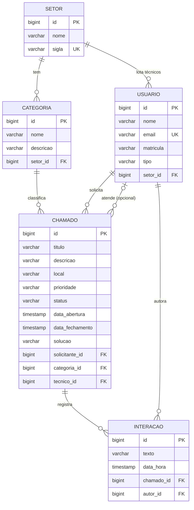

# Sistema de Chamados de Suporte do IFRN — API REST

> Projeto da disciplina **Desenvolvimento de Sistemas Corporativos** (TADS — IFRN Campus Pau dos Ferros, 2026.2).
> API REST em **Java 21 + Spring Boot 4 + Spring Data JPA + PostgreSQL**, com esquema versionado por **Flyway** e entrega em **Docker**.

Hoje, quando um projetor para de funcionar ou o Wi-Fi do laboratório cai, o servidor ou aluno avisa o setor responsável por WhatsApp, e-mail ou pessoalmente — sem registro, sem prioridade e sem histórico. Esta API centraliza esses pedidos: o solicitante abre um chamado informando o problema, o local e a categoria; o chamado vai para o setor responsável (COTIC para TI, Manutenção para infraestrutura), onde um técnico o assume, registra o andamento e o encerra. O solicitante acompanha tudo pelo histórico.

---

## Sumário

- [O que o sistema faz](#o-que-o-sistema-faz)
- [Como executar](#como-executar)
- [Como testar a aplicação](#como-testar-a-aplicação)
- [Stack](#stack)
- [Arquitetura em camadas](#arquitetura-em-camadas)
- [Modelo de dados](#modelo-de-dados)
- [Ciclo de vida e regras de negócio](#ciclo-de-vida-e-regras-de-negócio)
- [Endpoints](#endpoints)
- [Paginação e filtros](#paginação-e-filtros)
- [Formato padronizado de erro](#formato-padronizado-de-erro)
- [Exemplos de requisição e resposta](#exemplos-de-requisição-e-resposta)
- [Dados iniciais](#dados-iniciais)
- [Flyway: por que migrations e não `ddl-auto=update`](#flyway-por-que-migrations-e-não-ddl-autoupdate)
- [Testes automatizados](#testes-automatizados)
- [Decisões arquiteturais e por que foram tomadas](#decisões-arquiteturais-e-por-que-foram-tomadas)
- [Estrutura do repositório](#estrutura-do-repositório)

---

## O que o sistema faz

**Em uma frase:** registra, encaminha e acompanha pedidos de suporte do IFRN — o servidor ou aluno abre um chamado dizendo o que quebrou e onde; o chamado cai no setor responsável pela categoria escolhida; um técnico **daquele setor** assume, registra o andamento e encerra com a solução; tudo fica com data, responsável e histórico.

### O que cada perfil consegue fazer

| Perfil | Ações |
| --- | --- |
| **Solicitante** (servidor/aluno) | abrir chamado com título, descrição, local, categoria e prioridade; acompanhar o status e o histórico; responder com novas interações; cancelar enquanto o chamado estiver `ABERTO`; listar todos os seus chamados filtrando por status |
| **Técnico** | listar os chamados `ABERTO` do seu setor; assumir um chamado (o que o vincula a ele e muda o status para `EM_ATENDIMENTO`); registrar cada passo do atendimento como interação; resolver o chamado descrevendo obrigatoriamente a solução; consultar os chamados que atende |
| **Gestão / administração** | cadastrar e manter setores, categorias e usuários; consultar chamados por status, prioridade, setor, categoria, solicitante, técnico e **período**; auditar quem abriu, quem atendeu, quando abriu, quando fechou e qual foi a solução |

### O domínio modelado

| Entidade | O que guarda | Integridade |
| --- | --- | --- |
| **Setor** | `nome`, `sigla` | sigla **única** (sem diferenciar maiúsculas); dono das categorias e lotação dos técnicos |
| **Categoria** | `nome`, `descricao` | pertence **obrigatoriamente** a um setor — é ela que define **quem** atende o chamado |
| **Usuario** | `nome`, `email`, `matricula`, `tipo` | email **único**; `tipo` ∈ `SOLICITANTE`/`TECNICO`; técnico **precisa** de setor, solicitante **não pode** ter |
| **Chamado** | `titulo`, `descricao`, `local`, `prioridade`, `status`, `dataAbertura`, `dataFechamento`, `solucao` | 1 solicitante, 1 categoria e 0..1 técnico; `prioridade` ∈ BAIXA/MEDIA/ALTA; `status` ∈ ABERTO/EM_ATENDIMENTO/RESOLVIDO/CANCELADO |
| **Interacao** | `texto`, `dataHora` | pertence a um chamado e tem um autor — é o histórico de andamento |

No banco são 5 tabelas com PK, FK, `unique (sigla)`, `unique (email)`, `check` nos três enums e **11 índices** nas colunas usadas em filtro e ordenação.

### Capacidade por recurso

| Recurso | O que a API faz com ele | Endpoints |
| --- | --- | --- |
| **Setores** | cria, lista (filtro por nome), detalha, atualiza, exclui com proteção de vínculos e lista as categorias do setor | 6 |
| **Categorias** | cria vinculada a um setor, lista (nome + setor), detalha com o setor aninhado, atualiza (inclusive trocando de setor), exclui com proteção | 5 |
| **Usuários** | cria validando tipo/setor e email único, lista (nome + tipo + setor), detalha, atualiza e lista os chamados em que é solicitante **ou** técnico | 5 |
| **Chamados** | abre, lista com 8 filtros combináveis, detalha **com o histórico de interações** e executa as três transições do ciclo de vida + registro de interações | 7 |
| **Índice** | `GET /` lista todas as rotas em JSON, para descobrir a API sem ler código | 1 |

**24 endpoints** no total — detalhados em [Endpoints](#endpoints).

### Perguntas de negócio que a API responde

```
Quais chamados de TI estão abertos agora, dos mais urgentes para os mais antigos?
  GET /chamados?status=ABERTO&setorId=1&prioridade=ALTA&sort=dataAbertura,asc

O que aconteceu com o chamado 3, quem atendeu e qual foi a solução?
  GET /chamados/3

Quantos chamados a COTIC abriu e fechou em outubro?
  GET /chamados?setorId=1&dataInicio=2026-10-01&dataFim=2026-10-31

O que o técnico 4 tem em andamento?
  GET /usuarios/4/chamados?status=EM_ATENDIMENTO

Quais técnicos estão lotados na Manutenção?
  GET /usuarios?tipo=TECNICO&setorId=2
```

### O ciclo de vida que ele impõe

```
ABERTO ──assumir──► EM_ATENDIMENTO ──resolver──► RESOLVIDO
   │
   └────cancelar───► CANCELADO            (RESOLVIDO e CANCELADO são terminais)
```

Nenhuma outra transição existe, e cada passo tem dono: só o solicitante abre e cancela, só o técnico do setor assume, só o técnico atribuído resolve. As 8 regras estão em [Ciclo de vida e regras de negócio](#ciclo-de-vida-e-regras-de-negócio).

### O que o sistema **não** faz (limites conscientes)

- **Sem autenticação nem autorização** (login, JWT, perfis) — decisão do enunciado; quem executa a ação é informado no corpo (`solicitanteId`, `tecnicoId`, `autorId`) e validado no service.
- **Sem `DELETE /usuarios` nem `DELETE /chamados`** — apagaria o histórico; chamado encerrado é registro permanente.
- **Sem reabertura, reatribuição ou transferência de técnico** — o ciclo é terminal e `assumir` só vale para chamado `ABERTO`.
- **Sem anexos, notificações por e-mail, SLA/prazos, métricas ou relatórios prontos** — os dados para calcular tudo isso existem, mas não há endpoint de indicador.
- **Sem frontend e sem Swagger/OpenAPI** — a documentação é este README, o `requisicoes.http` e a coleção Postman; o `GET /` serve de índice de rotas.
- **Sem soft delete, auditoria de alterações (quem mudou o quê) ou cache.**

---

## Como executar

### Com Docker (recomendado — não exige nada instalado além do Docker)

```bash
git clone https://github.com/SEU-USUARIO/sistema-chamados.git
cd sistema-chamados
docker compose up --build
```

Pronto: a API responde em **http://localhost:8080** e o PostgreSQL em `localhost:5432`. Não há nenhum passo manual — o compose sobe o banco, espera ele ficar saudável (`healthcheck` com `pg_isready`), o Flyway cria as tabelas e insere os dados iniciais, e o Hibernate apenas valida o esquema.

```bash
curl http://localhost:8080/chamados?status=ABERTO     # já vem com 4 chamados de exemplo
docker compose down                                   # para os containers (mantém os dados)
docker compose down -v                                # para e apaga o volume do banco
```

> **Execução confirmada.** O build multi-stage e o compose foram validados em máquina real (Docker Compose v2, Linux): imagem `sistema-chamados:1.0.0` construída, `chamados-db` **Healthy** em ~6 s, `chamados-api` iniciada em seguida, Flyway aplicando `V1 → V2 → V3` num esquema vazio do **PostgreSQL 17.11** e Hibernate passando no `ddl-auto=validate` (`Started SistemaChamadosApplication in 5.532 seconds`). Os avisos `sh: locale: not found` e `enabling "trust" authentication for local connections` que aparecem no log do banco são normais da imagem `postgres:alpine` e não afetam nada.

`GET /` devolve um índice JSON com todas as rotas disponíveis.

As credenciais padrão são de **desenvolvimento** e podem ser sobrescritas por um arquivo `.env` (veja `.env.example`):

| Variável | Padrão | Descrição |
| --- | --- | --- |
| `POSTGRES_DB` | `chamados` | nome do banco |
| `POSTGRES_USER` | `chamados` | usuário do banco |
| `POSTGRES_PASSWORD` | `chamados123` | senha (**troque em produção**) |
| `POSTGRES_PORT` | `5432` | porta do banco publicada no host |
| `API_PORT` | `8080` | porta da API publicada no host |

### Sem Docker (Java 21 + Maven + um PostgreSQL local)

A configuração do banco vem **sempre de variáveis de ambiente** — não há senha fixa no `application.properties`.

```bash
export DB_URL=jdbc:postgresql://localhost:5432/chamados
export DB_USERNAME=chamados
export DB_PASSWORD=sua-senha          # obrigatória: a aplicação não sobe sem ela

mvn spring-boot:run                   # ou: mvn clean package && java -jar target/sistema-chamados-1.0.0.jar
mvn test                              # roda os testes (não precisam de banco)
```

| Variável | Padrão | Descrição |
| --- | --- | --- |
| `DB_URL` | `jdbc:postgresql://localhost:5432/chamados` | URL JDBC |
| `DB_USERNAME` | `chamados` | usuário |
| `DB_PASSWORD` | *sem padrão* | senha do banco |
| `SERVER_PORT` | `8080` | porta HTTP |
| `SHOW_SQL` | `false` | loga o SQL gerado |

---

## Como testar a aplicação

Com os containers de pé (`docker compose ps` deve mostrar `chamados-db` como **healthy** e `chamados-api` como **running**), há quatro caminhos — do mais rápido ao mais completo.

### 1. Teste de fumaça (30 segundos)

```bash
curl -s http://localhost:8080/ | python3 -m json.tool      # índice com todas as rotas
curl -s 'http://localhost:8080/chamados' | python3 -m json.tool   # 4 chamados semeados (um por status)
curl -s 'http://localhost:8080/usuarios?tipo=TECNICO' | python3 -m json.tool
```

No navegador também funciona para qualquer `GET`: <http://localhost:8080/setores>, <http://localhost:8080/categorias?setorId=1>, <http://localhost:8080/chamados/1> (este traz o histórico de interações), <http://localhost:8080/chamados?status=ABERTO&prioridade=ALTA&sort=dataAbertura,desc>.

### 2. Ciclo de vida completo no terminal

Um chamado do começo ao fim, usando os dados semeados (solicitante `1`, técnico da COTIC `4`, categoria `2`):

```bash
# 1) SOLICITANTE abre o chamado -> 201 + header Location
curl -i -X POST http://localhost:8080/chamados -H 'Content-Type: application/json' -d '{
  "titulo": "Impressora do setor financeiro não imprime",
  "descricao": "A fila de impressão trava e o led fica piscando.",
  "local": "Setor Financeiro - Bloco Administrativo",
  "categoriaId": 2,
  "solicitanteId": 1
}'

# 2) TÉCNICO do setor da categoria assume -> 200, status vira EM_ATENDIMENTO
curl -X PATCH http://localhost:8080/chamados/5/assumir -H 'Content-Type: application/json' -d '{"tecnicoId": 4}'

# 3) TÉCNICO atribuído registra andamento -> 201
curl -i -X POST http://localhost:8080/chamados/5/interacoes -H 'Content-Type: application/json' -d '{
  "texto": "Verifiquei a fila no servidor; vou reiniciar o spooler.", "autorId": 4
}'

# 4) Solicitante acompanha -> 200 com a interação no histórico
curl -s http://localhost:8080/chamados/5 | python3 -m json.tool

# 5) TÉCNICO atribuído resolve com a solução -> 200, RESOLVIDO + dataFechamento
curl -X PATCH http://localhost:8080/chamados/5/resolver -H 'Content-Type: application/json' -d '{
  "tecnicoId": 4, "solucao": "Spooler reiniciado e driver atualizado. Impressão de teste validada."
}'

# 6) Chamado encerrado não aceita mais nada (regra 6) -> 409
curl -X POST http://localhost:8080/chamados/5/interacoes -H 'Content-Type: application/json' -d '{
  "texto": "Só conferindo se voltou.", "autorId": 1
}'
```

> Troque o `5` pelo id que aparecer no `Location` do passo 1 se o seu banco já tiver outros chamados criados.

### 3. As 8 regras de negócio, uma requisição para cada

| # | O que testar | Requisição | Esperado |
| --- | --- | --- | --- |
| 1 | Prioridade e status padrão | `POST /chamados` sem `prioridade` | 201 com `MEDIA`, `ABERTO` e `dataAbertura` preenchida |
| 2 | Só solicitante abre chamado | `POST /chamados` com `"solicitanteId": 4` (que é `TECNICO`) | 409 |
| 3 | Técnico de outro setor | `PATCH /chamados/1/assumir` com `{"tecnicoId": 6}` (MANUT) | 409 |
| 3 | Técnico do setor certo | `PATCH /chamados/1/assumir` com `{"tecnicoId": 4}` (COTIC) | 200 |
| 4 | Solução obrigatória | `PATCH /chamados/{id}/resolver` com `"solucao": ""` | 400 |
| 4 | Quem não é o técnico atribuído | `PATCH /chamados/2/resolver` com `{"tecnicoId": 4}` (o atribuído é o 6) | 409 |
| 5 | Outro usuário tentando cancelar | `PATCH /chamados/1/cancelar` com `{"solicitanteId": 2}` | 409 |
| 5 | O próprio solicitante, ainda `ABERTO` | `PATCH /chamados/1/cancelar` com `{"solicitanteId": 1}` | 200 |
| 6 | Chamado encerrado | qualquer `PATCH` ou `POST .../interacoes` em `/chamados/3` (RESOLVIDO) ou `/chamados/4` (CANCELADO) | 409 |
| 7 | Interação de quem não participa | `POST /chamados/2/interacoes` com `{"autorId": 1}` | 409 |
| 8 | Excluir setor com vínculos | `DELETE /setores/1` | 409 |
| 8 | Excluir categoria com vínculos | `DELETE /categorias/1` | 409 |
| — | E-mail duplicado | `POST /usuarios` com `maria.silva@ifrn.edu.br` | 409 |
| — | Recurso inexistente | `GET /setores/999` | 404 |
| — | Dado inválido | `POST /setores` com `{"nome":"","sigla":""}` | 400 com `erros[]` por campo |
| — | Método não suportado | `DELETE /setores` | 405 |

Todos devolvem o mesmo envelope `{timestamp, status, mensagem, caminho}`.

> **A ordem importa.** Cada requisição muda o estado do banco — se você assumir o chamado `1` (linha 3), ele deixa de ser `ABERTO` e o cancelamento da linha 5 passa a devolver 409. Quando um resultado vier diferente do esperado, confira o estado atual com `GET /chamados/{id}` ou recomece do zero com `docker compose down -v && docker compose up -d`.

### 4. `requisicoes.http` no VS Code ou IntelliJ

Instale a extensão **REST Client** (humao.rest-client) no VS Code, abra `requisicoes.http` e clique em **Send Request** acima de cada bloco. São **76 requisições** já na ordem certa — os blocos reaproveitam os ids criados pelos anteriores (`# @name` + `{{idChamado}}`). A variável `@host = http://localhost:8080` já bate com o compose. O IntelliJ IDEA abre o mesmo arquivo nativamente.

### 5. Coleção Postman (ou Insomnia)

```
Postman → Import → postman/Sistema-de-Chamados-IFRN.postman_collection.json
```

São **82 requisições em 6 pastas**, com a variável `baseUrl = http://localhost:8080` e scripts que guardam automaticamente os ids criados (`idSetorNovo`, `idChamadoNovo`…). Para rodar tudo de uma vez: clique com o botão direito na coleção → **Run collection** → **Run**. Cada requisição tem o código HTTP esperado no próprio nome (ex.: `Assumir com técnico de outro setor (409)`), então o Runner mostra verde/vermelho. No Insomnia, o mesmo JSON importa sem ajuste.

> Dica: rode a coleção com o banco limpo (`docker compose down -v && docker compose up -d`), porque ela cria setores, usuários e chamados novos.

### 6. Conferindo o banco e o Flyway por dentro

```bash
docker compose exec db psql -U chamados -d chamados -c '\dt'
docker compose exec db psql -U chamados -d chamados -c \
  'select installed_rank, version, description, checksum, success from flyway_schema_history order by installed_rank;'
docker compose exec db psql -U chamados -d chamados -c \
  'select id, titulo, status, prioridade from chamados order by id;'

docker compose logs -f api        # log da aplicação (Ctrl+C para sair)
docker compose ps                 # status dos containers
```

### 7. Resetando os dados

```bash
docker compose down -v && docker compose up -d    # apaga o volume e recria tudo do zero
```

O Flyway reaplica `V1`, `V2` e `V3` num esquema vazio e você volta a ter exatamente os dados iniciais documentados.

---

## Stack

| Camada | Tecnologia |
| --- | --- |
| Linguagem | Java 21 (records, `switch` expressions, text blocks) |
| Framework | Spring Boot 4.1.2 (Spring Framework 7, Tomcat 11) |
| Persistência | Spring Data JPA + Hibernate ORM 7.4 |
| Banco | PostgreSQL 17 (imagem Alpine no compose) |
| Migrations | Flyway 12 (`spring-boot-starter-flyway` + `flyway-database-postgresql`) |
| Validação | Jakarta Bean Validation (`spring-boot-starter-validation`) |
| Build | Maven 3.9 |
| Boilerplate | Lombok (somente nas entidades) |
| Testes | JUnit 5, Mockito, AssertJ, MockMvc |
| Entrega | Dockerfile multi-stage + `docker-compose.yml` |

---

## Arquitetura em camadas

```
src/main/java/br/edu/ifrn/chamados/
├── SistemaChamadosApplication.java   # bootstrap
├── controller/                       # recebe a requisição, chama o service, devolve a resposta
│   ├── ApiIndexController.java       # GET / (índice de rotas - conveniência)
│   ├── SetorController.java
│   ├── CategoriaController.java
│   ├── UsuarioController.java
│   └── ChamadoController.java
├── service/                          # TODAS as regras de negócio e as transações
│   ├── SetorService.java
│   ├── CategoriaService.java
│   ├── UsuarioService.java
│   └── ChamadoService.java           # ciclo de vida do chamado (regras 1 a 7)
├── repository/                       # interfaces que estendem JpaRepository
│   ├── SetorRepository.java
│   ├── CategoriaRepository.java
│   ├── UsuarioRepository.java
│   ├── ChamadoRepository.java        # filtros com @Query
│   └── InteracaoRepository.java      # filtro com método derivado
├── model/                            # entidades JPA e enums
│   ├── Setor.java  Categoria.java  Usuario.java  Chamado.java  Interacao.java
│   ├── Prioridade.java  StatusChamado.java  TipoUsuario.java
├── dto/                              # records de entrada (validados) e de saída
└── exception/                        # exceções próprias + @RestControllerAdvice
```

**Regras da arquitetura aplicada:**

- **Controller não tem regra de negócio.** Ele só faz binding/validação de entrada, chama o service e monta o `ResponseEntity` (status HTTP e `Location`).
- **Service concentra as regras** do enunciado e lança exceções próprias: `RegraNegocioException` (409), `RecursoNaoEncontradoException` (404) e `DadosInvalidosException` (400). Os métodos de escrita são `@Transactional` e os de leitura `@Transactional(readOnly = true)`.
- **Injeção de dependência por construtor** em todos os beans, sem `@Autowired` em atributo.
- **Repository estende `JpaRepository`**, com filtros por métodos derivados (`existsBySiglaIgnoreCase`, `findBySetorId`, `findByChamadoIdOrderByDataHoraAsc`) e por `@Query`.
- **DTOs em ambos os sentidos**: entities nunca vazam para o JSON (evita serialização de proxy lazy, laços entre relações bidirecionais e exposição de campos internos).
- **`spring.jpa.open-in-view=false`**: o mapeamento entity → DTO acontece dentro da transação do service, então nada é carregado fora dela.

---

## Modelo de dados

| Entidade | Atributos | Relacionamentos |
| --- | --- | --- |
| `Setor` | id, nome, **sigla (única)** | tem várias `categorias` e vários `tecnicos` |
| `Categoria` | id, nome, descricao | pertence a um `setor` |
| `Usuario` | id, nome, **email (único)**, matricula, tipo (`SOLICITANTE`/`TECNICO`) | técnico pertence a um `setor` |
| `Chamado` | id, titulo, descricao, local, prioridade, status, dataAbertura, dataFechamento, solucao | tem um `solicitante`, uma `categoria` e, opcionalmente, um `tecnico`; tem várias `interacoes` |
| `Interacao` | id, texto, dataHora | pertence a um `chamado` e tem um `autor` |



Detalhes do mapeamento JPA:

- `@ManyToOne` para `categoria.setor`, `usuario.setor`, `chamado.solicitante/categoria/tecnico`, `interacao.chamado/autor`; `@OneToMany(mappedBy = ...)` no lado inverso (`setor.categorias`, `setor.tecnicos`, `chamado.interacoes`).
- `@Enumerated(EnumType.STRING)` em `prioridade`, `status` e `tipo` — o banco guarda o nome legível, não o ordinal.
- `@OrderBy("dataHora ASC")` em `chamado.interacoes`, para o histórico sair sempre em ordem cronológica.
- Unicidade garantida **nas migrations** (`uk_setores_sigla`, `uk_usuarios_email`) e checada **no service** antes do insert, para devolver 409 com mensagem clara em vez de estourar violação de constraint.

---

## Ciclo de vida e regras de negócio

```
ABERTO ──assumir──► EM_ATENDIMENTO ──resolver──► RESOLVIDO
   │
   └────cancelar───► CANCELADO
```

Nenhuma outra transição é permitida. A máquina de estados fica no enum `StatusChamado.permiteTransicaoPara(...)`, e quem a aplica é o `ChamadoService.exigirTransicao(...)`.

| # | Regra | Implementação | HTTP em caso de violação |
| --- | --- | --- | --- |
| 1 | Chamado nasce `ABERTO`, com `dataAbertura` preenchida pelo sistema e prioridade `MEDIA` quando não informada | `ChamadoService.abrir` | — |
| 2 | Apenas `SOLICITANTE` abre chamado | `ChamadoService.abrir` | 409 |
| 3 | Técnico só assume chamado `ABERTO` cuja categoria pertença ao seu setor; ao assumir vira `EM_ATENDIMENTO` | `ChamadoService.assumir` | 409 |
| 4 | Somente o técnico atribuído resolve, com solução obrigatória; `dataFechamento` é preenchida | `ChamadoService.resolver` + `@NotBlank` no DTO | 409 (autoria) / 400 (solução vazia) |
| 5 | Somente o próprio solicitante cancela, e apenas enquanto `ABERTO` | `ChamadoService.cancelar` | 409 |
| 6 | `RESOLVIDO`/`CANCELADO` não aceitam alterações nem novas interações | `StatusChamado.isEncerrado` + `exigirTransicao` | 409 |
| 7 | Apenas o solicitante e o técnico atribuído registram interações | `ChamadoService.registrarInteracao` | 409 |
| 8 | Não é permitido excluir setor ou categoria com chamados vinculados | `SetorService.excluir` / `CategoriaService.excluir` | 409 |

Como o projeto **não usa autenticação**, o usuário que executa a ação vai no corpo da requisição (`solicitanteId`, `tecnicoId` ou `autorId`) e é validado no service.

---

## Endpoints

**Base:** `http://localhost:8080` · **Content-Type:** `application/json` em todas as escritas · **Sem autenticação** — quem executa a ação é informado no corpo (`solicitanteId`, `tecnicoId`, `autorId`).

Convenções usadas em toda a API:

- criação devolve **`201 Created`** com o header **`Location`** apontando para o recurso;
- exclusão devolve **`204 No Content`** sem corpo;
- transições de status usam **`PATCH`** (são comandos, não substituição de recurso);
- toda listagem devolve o envelope de paginação `{content, page, size, totalElements, totalPages}`;
- toda falha devolve `{timestamp, status, mensagem, caminho}` — e `409` sempre que uma **regra de negócio** é violada.

### Visão geral (24 endpoints)

| # | Método e rota | O que faz | Sucesso |
| --- | --- | --- | --- |
| 1 | `GET /` | índice da API com todas as rotas | 200 |
| 2 | `POST /setores` | cria um setor | 201 |
| 3 | `GET /setores` | lista setores (filtro `nome`) | 200 |
| 4 | `GET /setores/{id}` | detalha um setor | 200 |
| 5 | `PUT /setores/{id}` | atualiza nome e sigla | 200 |
| 6 | `DELETE /setores/{id}` | exclui um setor sem vínculos | 204 |
| 7 | `GET /setores/{id}/categorias` | categorias do setor | 200 |
| 8 | `POST /categorias` | cria categoria em um setor | 201 |
| 9 | `GET /categorias` | lista categorias (filtros `nome`, `setorId`) | 200 |
| 10 | `GET /categorias/{id}` | detalha com o setor aninhado | 200 |
| 11 | `PUT /categorias/{id}` | atualiza nome, descrição e setor | 200 |
| 12 | `DELETE /categorias/{id}` | exclui categoria sem chamados | 204 |
| 13 | `POST /usuarios` | cria solicitante ou técnico | 201 |
| 14 | `GET /usuarios` | lista usuários (filtros `nome`, `tipo`, `setorId`) | 200 |
| 15 | `GET /usuarios/{id}` | detalha um usuário | 200 |
| 16 | `PUT /usuarios/{id}` | atualiza os dados do usuário | 200 |
| 17 | `GET /usuarios/{id}/chamados` | chamados do usuário (filtro `status`) | 200 |
| 18 | `POST /chamados` | abre um chamado | 201 |
| 19 | `GET /chamados` | lista chamados (8 filtros combináveis) | 200 |
| 20 | `GET /chamados/{id}` | detalha **com o histórico de interações** | 200 |
| 21 | `PATCH /chamados/{id}/assumir` | técnico assume → `EM_ATENDIMENTO` | 200 |
| 22 | `PATCH /chamados/{id}/resolver` | técnico resolve → `RESOLVIDO` | 200 |
| 23 | `PATCH /chamados/{id}/cancelar` | solicitante cancela → `CANCELADO` | 200 |
| 24 | `POST /chamados/{id}/interacoes` | registra uma interação | 201 |

### Formatos de resposta

| DTO | Campos |
| --- | --- |
| `SetorResponse` | `id`, `nome`, `sigla` |
| `CategoriaResponse` | `id`, `nome`, `descricao`, `setor` (SetorResponse) |
| `UsuarioResponse` | `id`, `nome`, `email`, `matricula`, `tipo`, `setor` (SetorResponse **ou `null`** para solicitante) |
| `ChamadoResponse` | `id`, `titulo`, `descricao`, `local`, `prioridade`, `status`, `dataAbertura`, `dataFechamento`, `solucao`, `solicitante`, `tecnico` (ou `null`), `categoria`, `interacoes[]` |
| `InteracaoResponse` | `id`, `texto`, `dataHora`, `autor` (UsuarioResponse) |
| `PageResponse<T>` | `content[]`, `page`, `size`, `totalElements`, `totalPages` |

> `interacoes[]` só vem preenchido em `GET /chamados/{id}`; nas listagens e nas respostas das transições volta vazio.

---

### Índice

#### 1. `GET /` — índice da API
Devolve um JSON auto-descritivo com nome da API, descrição, stack, onde está a documentação, como paginar, o formato de erro e **a lista de todas as rotas** agrupadas por recurso (método, caminho e descrição). Não recebe parâmetros.
- **Sucesso:** `200` com o índice.
- **Utilidade:** permite descobrir a API só com o navegador, já que o projeto não usa Swagger.

---

### Setores — `/setores`

#### 2. `POST /setores` — cria um setor
Cadastra o setor que será dono de categorias e lotação de técnicos. Os textos são gravados com `trim()` e a sigla é comparada sem diferenciar maiúsculas.
- **Corpo:** `nome` (string, obrigatório, máx. 120) · `sigla` (string, obrigatório, máx. 20, **única**)
- **Sucesso:** `201 Created` + `Location: /setores/{id}` com `SetorResponse`
- **Erros:** `400` campo vazio ou acima do limite · `409` já existe setor com essa sigla · `415` `Content-Type` diferente de `application/json`

#### 3. `GET /setores` — lista setores
Lista paginada, ordenada por `nome` ASC por padrão.
- **Query:** `nome` (opcional — contém, ignorando maiúsculas) · `page` · `size` · `sort`
- **Sucesso:** `200` com `PageResponse<SetorResponse>`
- **Erros:** `400` valor malformado na query string

#### 4. `GET /setores/{id}` — detalha um setor
- **Path:** `id` (numérico)
- **Sucesso:** `200` com `SetorResponse`
- **Erros:** `404` setor inexistente · `400` `id` não numérico

#### 5. `PUT /setores/{id}` — atualiza um setor
Substitui nome e sigla. A unicidade da sigla é conferida **excluindo o próprio registro**, então reenviar os mesmos dados não gera conflito.
- **Corpo:** igual ao do `POST` (`nome`, `sigla`)
- **Sucesso:** `200` com o `SetorResponse` atualizado
- **Erros:** `404` setor inexistente · `409` a sigla já pertence a **outro** setor · `400` validação

#### 6. `DELETE /setores/{id}` — exclui um setor
Exclui apenas se o setor não tiver nada pendurado nele.
- **Sucesso:** `204 No Content`
- **Erros:** `404` inexistente · `409` em três situações distintas, cada uma com sua mensagem: há **chamados** vinculados (regra 8, checado via categorias do setor), há **categorias** cadastradas ou há **técnicos** lotados

#### 7. `GET /setores/{id}/categorias` — categorias do setor
Atalho para listar as categorias de um setor, paginado e ordenado por `nome`.
- **Path:** `id` do setor · **Query:** `page`, `size`, `sort`
- **Sucesso:** `200` com `PageResponse<CategoriaResponse>`
- **Erros:** `404` setor inexistente

---

### Categorias — `/categorias`

#### 8. `POST /categorias` — cria uma categoria
A categoria é o que **define qual setor atende o chamado**, por isso `setorId` é obrigatório e precisa existir.
- **Corpo:** `nome` (obrigatório, máx. 120) · `descricao` (obrigatório, máx. 500) · `setorId` (obrigatório)
- **Sucesso:** `201 Created` + `Location: /categorias/{id}` com `CategoriaResponse` (já com o setor aninhado)
- **Erros:** `400` campo vazio/acima do limite ou `setorId` ausente · `404` setor inexistente

#### 9. `GET /categorias` — lista categorias
- **Query:** `nome` (opcional, contém) · `setorId` (opcional) · `page` · `size` · `sort` — os dois filtros combinam entre si
- **Sucesso:** `200` com `PageResponse<CategoriaResponse>`, ordem padrão `nome` ASC
- **Erros:** `404` `setorId` inexistente · `400` parâmetro malformado

#### 10. `GET /categorias/{id}` — detalha uma categoria
- **Sucesso:** `200` com `CategoriaResponse`
- **Erros:** `404` categoria inexistente

#### 11. `PUT /categorias/{id}` — atualiza uma categoria
Atualiza nome, descrição e **permite transferir a categoria para outro setor** — o que muda automaticamente quem passará a atender os chamados abertos a partir dali (os chamados antigos mantêm o histórico).
- **Corpo:** igual ao do `POST`
- **Sucesso:** `200` com a categoria atualizada
- **Erros:** `404` categoria ou setor inexistente · `400` validação

#### 12. `DELETE /categorias/{id}` — exclui uma categoria
- **Sucesso:** `204 No Content`
- **Erros:** `404` inexistente · `409` há chamados vinculados à categoria (regra 8)

---

### Usuários — `/usuarios`

#### 13. `POST /usuarios` — cria um usuário
O `tipo` define o que o usuário pode fazer: `SOLICITANTE` abre chamados, `TECNICO` assume e resolve. O vínculo com setor é coerente com o tipo.
- **Corpo:** `nome` (obrigatório, máx. 120) · `email` (obrigatório, formato válido, máx. 160, **único**) · `matricula` (obrigatório, máx. 30) · `tipo` (obrigatório: `SOLICITANTE` ou `TECNICO`) · `setorId` (obrigatório para `TECNICO`, **proibido** para `SOLICITANTE`)
- **Sucesso:** `201 Created` + `Location: /usuarios/{id}` com `UsuarioResponse`
- **Erros:** `400` validação de campos, `TECNICO` sem `setorId` ou `SOLICITANTE` com `setorId` · `409` e-mail já cadastrado (comparado sem diferenciar maiúsculas) · `404` `setorId` inexistente

#### 14. `GET /usuarios` — lista usuários
- **Query:** `nome` (contém) · `tipo` (`SOLICITANTE`/`TECNICO`) · `setorId` · `page` · `size` · `sort` — combináveis; ordem padrão `nome` ASC
- **Sucesso:** `200` com `PageResponse<UsuarioResponse>`
- **Erros:** `404` `setorId` inexistente · `400` `tipo` fora do enum

#### 15. `GET /usuarios/{id}` — detalha um usuário
- **Sucesso:** `200` com `UsuarioResponse` (com o setor, quando técnico)
- **Erros:** `404` usuário inexistente

#### 16. `PUT /usuarios/{id}` — atualiza um usuário
Atualiza todos os campos, inclusive `tipo` e `setorId` (um técnico pode virar solicitante e vice-versa), repetindo as mesmas validações da criação. O e-mail é verificado contra os **outros** usuários.
- **Corpo:** igual ao do `POST`
- **Sucesso:** `200` com o usuário atualizado
- **Erros:** `404` usuário ou setor inexistente · `409` e-mail de outro usuário · `400` validação

#### 17. `GET /usuarios/{id}/chamados` — chamados do usuário
Devolve os chamados em que o usuário é **solicitante OU técnico atribuído**, ordenados do mais recente para o mais antigo. É a visão "meus chamados".
- **Path:** `id` do usuário · **Query:** `status` (opcional) · `page` · `size` · `sort`
- **Sucesso:** `200` com `PageResponse<ChamadoResponse>`
- **Erros:** `404` usuário inexistente · `400` `status` fora do enum

> **Não existe `DELETE /usuarios`:** o usuário é referenciado por chamados e interações; apagá-lo destruiria o histórico de atendimento.

---

### Chamados — `/chamados`

#### 18. `POST /chamados` — abre um chamado
É o ponto de entrada do fluxo. O sistema define o que é dele: `status = ABERTO`, `dataAbertura = agora` e `prioridade = MEDIA` quando o solicitante não informa (regra 1).
- **Corpo:** `titulo` (obrigatório, máx. 150) · `descricao` (obrigatório, máx. 2000) · `local` (obrigatório, máx. 120) · `prioridade` (**opcional**: `BAIXA`/`MEDIA`/`ALTA`) · `categoriaId` (obrigatório) · `solicitanteId` (obrigatório)
- **Sucesso:** `201 Created` + `Location: /chamados/{id}` com `ChamadoResponse` completo (solicitante, categoria com setor e `interacoes` vazio)
- **Erros:** `400` campo vazio/acima do limite, `categoriaId`/`solicitanteId` ausentes ou `prioridade` fora do enum · `404` categoria ou solicitante inexistente · `409` o `solicitanteId` é de um usuário `TECNICO` (regra 2)

#### 19. `GET /chamados` — lista chamados
A consulta de triagem: todos os filtros são opcionais e **combináveis entre si**; o que não é informado é ignorado. Ordem padrão `dataAbertura DESC`.
- **Query:** `status` · `prioridade` · `setorId` (setor responsável, via categoria) · `categoriaId` · `solicitanteId` · `tecnicoId` · `dataInicio` (`yyyy-MM-dd`, inclusive) · `dataFim` (`yyyy-MM-dd`, inclusive — o dia inteiro, até 23:59:59) · `page` · `size` · `sort`
- **Sucesso:** `200` com `PageResponse<ChamadoResponse>` (sem as interações)
- **Erros:** `400` enum inválido, data fora do formato ISO ou parâmetro não numérico

#### 20. `GET /chamados/{id}` — detalha o chamado
Único endpoint que traz o **histórico completo de interações em ordem cronológica**, cada uma com seu autor.
- **Sucesso:** `200` com `ChamadoResponse` + `interacoes[]`
- **Erros:** `404` chamado inexistente

#### 21. `PATCH /chamados/{id}/assumir` — técnico assume o chamado
Vincula o técnico ao chamado e muda o status para `EM_ATENDIMENTO`. Concentra a regra 3: precisa ser `TECNICO`, o chamado precisa estar `ABERTO` e o setor do técnico precisa ser **o setor da categoria do chamado**.
- **Corpo:** `tecnicoId` (obrigatório)
- **Sucesso:** `200` com o `ChamadoResponse` já com `status = EM_ATENDIMENTO` e `tecnico` preenchido
- **Erros:** `400` `tecnicoId` ausente · `404` chamado ou técnico inexistente · `409` o usuário não é `TECNICO` · `409` transição inválida: chamado já em atendimento, resolvido ou cancelado (regras 3 e 6) · `409` técnico sem setor de lotação · `409` técnico de **outro** setor (a mensagem nomeia a categoria, o setor do chamado e o setor do técnico)

#### 22. `PATCH /chamados/{id}/resolver` — técnico resolve o chamado
Encerra o atendimento com a solução obrigatória, gravando `dataFechamento = agora` (regra 4).
- **Corpo:** `tecnicoId` (obrigatório) · `solucao` (obrigatório, não pode ser vazio, máx. 2000)
- **Sucesso:** `200` com `status = RESOLVIDO`, `solucao` e `dataFechamento` preenchidos
- **Erros:** `400` solução ausente/vazia ou acima de 2000 caracteres · `404` chamado ou técnico inexistente · `409` o usuário não é `TECNICO` · `409` transição inválida (só `EM_ATENDIMENTO → RESOLVIDO`) · `409` o técnico **não é o atribuído** ao chamado

#### 23. `PATCH /chamados/{id}/cancelar` — solicitante cancela o chamado
Desiste do pedido enquanto ninguém começou a atender; grava `dataFechamento` (regras 5 e 6).
- **Corpo:** `solicitanteId` (obrigatório)
- **Sucesso:** `200` com `status = CANCELADO` e `dataFechamento` preenchido
- **Erros:** `400` `solicitanteId` ausente · `404` chamado ou usuário inexistente · `409` quem tenta cancelar **não é o solicitante que abriu** · `409` o chamado não está mais `ABERTO` (em atendimento, resolvido ou cancelado)

#### 24. `POST /chamados/{id}/interacoes` — registra uma interação
Cada passo do atendimento (ou cada resposta do solicitante) vira um registro datado e com autor — é o histórico do chamado. Só vale com o chamado ainda em andamento (regras 6 e 7).
- **Corpo:** `texto` (obrigatório, máx. 2000) · `autorId` (obrigatório)
- **Sucesso:** `201 Created` + `Location: /chamados/{id}` (aponta para o chamado dono do histórico) com `InteracaoResponse` — `dataHora` é definida pelo sistema
- **Erros:** `400` texto vazio/acima do limite ou `autorId` ausente · `404` chamado ou autor inexistente · `409` chamado `RESOLVIDO`/`CANCELADO` não aceita novas interações · `409` o autor não é o solicitante nem o técnico atribuído

> **Não existe `DELETE /chamados`:** chamado encerrado é registro permanente de auditoria.

---

## Paginação e filtros

Toda rota de listagem é paginada com o `Pageable` do Spring Data: `page` (inicia em 0), `size` (padrão **10**, máximo **50**) e `sort`.

```
GET /chamados?status=ABERTO&setorId=1&prioridade=ALTA&page=0&size=10&sort=dataAbertura,desc
```

```json
{
  "content": [ { "id": 1, "titulo": "Wi-Fi do Laboratório de Informática 2 fora do ar", "...": "..." } ],
  "page": 0,
  "size": 10,
  "totalElements": 1,
  "totalPages": 1
}
```

O limite de 50 e o tamanho padrão de 10 vêm de configuração (`spring.data.web.pageable.default-page-size` / `max-page-size`), então `?size=500` devolve no máximo 50 itens.

Filtros combináveis entre si — filtro não informado é ignorado:

| Listagem | Filtros |
| --- | --- |
| `GET /setores` | `nome` (contém, sem diferenciar maiúsculas) |
| `GET /categorias` | `nome`, `setorId` |
| `GET /usuarios` | `nome`, `tipo`, `setorId` |
| `GET /chamados` | `status`, `prioridade`, `setorId`, `categoriaId`, `solicitanteId`, `tecnicoId`, `dataInicio`, `dataFim` |
| `GET /usuarios/{id}/chamados` | `status` |

Os filtros são resolvidos em uma única consulta `@Query` por recurso. Duas observações técnicas que custaram alguns testes:

- Em filtros de texto o parâmetro aparece como `cast(:nome as string)`. Sem o cast, o PostgreSQL não consegue inferir o tipo de um parâmetro nulo e a consulta falha com `function lower(bytea) does not exist`.
- O período de abertura usa duas flags booleanas (`:filtrarInicio`, `:filtrarFim`) pelo mesmo motivo: parâmetro `timestamp` nulo sem tipo gera `could not determine data type of parameter`.
- Os `left join` de `categoria → setor` e `tecnico` evitam que chamados sem técnico desapareçam quando o filtro não é informado.

`dataInicio` e `dataFim` são datas (`yyyy-MM-dd`) e viram os limites do dia no service: `00:00:00` e `23:59:59.999999`.

---

## Formato padronizado de erro

Todo erro — de qualquer recurso — devolve o mesmo JSON, gerado pelo `@RestControllerAdvice` (`GlobalExceptionHandler`):

```json
{
  "timestamp": "2026-10-29T09:14:02.117",
  "status": 409,
  "mensagem": "Somente o técnico atribuído ao chamado pode resolvê-lo (regra 4).",
  "caminho": "/chamados/3/resolver"
}
```

Erros de validação acrescentam o detalhamento por campo:

```json
{
  "timestamp": "2026-10-29T09:15:31.904",
  "status": 400,
  "mensagem": "Falha de validação: 2 campo(s) inválido(s) na requisição.",
  "caminho": "/setores",
  "erros": [
    { "campo": "sigla", "mensagem": "A sigla do setor é obrigatória." },
    { "campo": "nome",  "mensagem": "O nome do setor é obrigatório." }
  ]
}
```

| Código | Quando |
| --- | --- |
| 400 | dado inválido: campo obrigatório vazio, e-mail mal formatado, JSON malformado, enum/`id` inválido na query string |
| 404 | recurso inexistente (inclusive rota inexistente) |
| 405 | método HTTP não suportado pela rota |
| 409 | violação de regra de negócio: transição de status inválida, técnico de outro setor, e-mail/sigla duplicados, exclusão com vínculos |
| 415 | `Content-Type` diferente de `application/json` |
| 500 | erro inesperado (logado com stack trace, sem vazar detalhe interno para o cliente) |

---

## Exemplos de requisição e resposta

Todos os exemplos foram **executados de verdade** contra a API rodando com PostgreSQL: as requisições são copiáveis como estão e as **mensagens de resposta são literais** (as de erro saíram direto do terminal). O que muda a cada execução é apenas `timestamp`, `dataAbertura`/`dataFechamento` e os ids dos recursos criados — o formato e o texto são sempre estes. Respostas marcadas com *(abreviada)* omitem campos repetidos só para caber na página.

Duas coleções prontas acompanham o projeto e cobrem exatamente estes casos:

- **`requisicoes.http`** — 76 requisições para o VS Code (extensão REST Client) ou IntelliJ, já na ordem certa de execução. Cada exemplo abaixo indica o bloco correspondente.
- **`postman/Sistema-de-Chamados-IFRN.postman_collection.json`** — 82 requisições em 6 pastas, com scripts que capturam os ids criados em variáveis de coleção. Importa também no Insomnia.
  Pastas: `1. Setores` (11) · `2. Categorias` (12) · `3. Usuarios` (16) · `4. Chamados - abertura e consulta` (18) · `5. Chamados - ciclo de vida` (21) · `6. Erros e rotas invalidas` (4).

### A. Ciclo de vida de um chamado (fluxo feliz)

#### A1. `POST /chamados` — solicitante abre um chamado *(bloco 4.1)*

```bash
curl -i -X POST http://localhost:8080/chamados \
  -H 'Content-Type: application/json' \
  -d '{
    "titulo": "Impressora do setor financeiro não imprime",
    "descricao": "A fila de impressão trava e o equipamento fica com o led piscando.",
    "local": "Setor Financeiro - Bloco Administrativo",
    "categoriaId": 2,
    "solicitanteId": 1
  }'
```

```
HTTP/1.1 201 Created
Location: http://localhost:8080/chamados/5
Content-Type: application/json
```
```json
{
  "id": 5,
  "titulo": "Impressora do setor financeiro não imprime",
  "descricao": "A fila de impressão trava e o equipamento fica com o led piscando.",
  "local": "Setor Financeiro - Bloco Administrativo",
  "prioridade": "MEDIA",
  "status": "ABERTO",
  "dataAbertura": "2026-10-29T15:20:11.435209",
  "dataFechamento": null,
  "solucao": null,
  "solicitante": { "id": 1, "nome": "Maria Silva de Souza", "email": "maria.silva@ifrn.edu.br",
                   "matricula": "2019123456", "tipo": "SOLICITANTE", "setor": null },
  "tecnico": null,
  "categoria": { "id": 2, "nome": "Equipamentos de Informática",
                 "descricao": "Computadores, notebooks, impressoras e periféricos dos setores e laboratórios.",
                 "setor": { "id": 1, "nome": "Coordenação de Tecnologia da Informação e Comunicação", "sigla": "COTIC" } },
  "interacoes": []
}
```

Regra 1 visível na resposta: `status: ABERTO`, `prioridade: MEDIA` (não foi enviada) e `dataAbertura` preenchida pelo sistema. O `Location` devolve a URL do recurso criado.

#### A2. `PATCH /chamados/5/assumir` — técnico do setor assume *(bloco 5.1)*

```bash
curl -X PATCH http://localhost:8080/chamados/5/assumir \
  -H 'Content-Type: application/json' -d '{"tecnicoId": 4}'
```

```json
{
  "id": 5,
  "titulo": "Impressora do setor financeiro não imprime",
  "descricao": "A fila de impressão trava e o equipamento fica com o led piscando.",
  "local": "Setor Financeiro - Bloco Administrativo",
  "prioridade": "MEDIA",
  "status": "EM_ATENDIMENTO",
  "dataAbertura": "2026-10-29T15:20:11.435209",
  "dataFechamento": null,
  "solucao": null,
  "solicitante": { "id": 1, "nome": "Maria Silva de Souza", "email": "maria.silva@ifrn.edu.br",
                   "matricula": "2019123456", "tipo": "SOLICITANTE", "setor": null },
  "tecnico": { "id": 4, "nome": "Carlos Eduardo Pereira", "email": "carlos.pereira@ifrn.edu.br",
               "matricula": "2015001122", "tipo": "TECNICO",
               "setor": { "id": 1, "nome": "Coordenação de Tecnologia da Informação e Comunicação", "sigla": "COTIC" } },
  "categoria": { "id": 2, "nome": "Equipamentos de Informática",
                 "descricao": "Computadores, notebooks, impressoras e periféricos dos setores e laboratórios.",
                 "setor": { "id": 1, "nome": "Coordenação de Tecnologia da Informação e Comunicação", "sigla": "COTIC" } },
  "interacoes": []
}
```

`status` mudou para `EM_ATENDIMENTO` e `tecnico` foi preenchido — o chamado agora tem dono.

#### A3. `POST /chamados/5/interacoes` — técnico registra o andamento *(bloco 5.6)*

```bash
curl -i -X POST http://localhost:8080/chamados/5/interacoes \
  -H 'Content-Type: application/json' \
  -d '{"texto": "Verifiquei a fila no servidor; vou reiniciar o spooler.", "autorId": 4}'
```

```
HTTP/1.1 201 Created
Location: http://localhost:8080/chamados/5
```
```json
{
  "id": 8,
  "texto": "Verifiquei a fila no servidor; vou reiniciar o spooler.",
  "dataHora": "2026-10-29T15:21:03.118442",
  "autor": { "id": 4, "nome": "Carlos Eduardo Pereira", "email": "carlos.pereira@ifrn.edu.br",
             "matricula": "2015001122", "tipo": "TECNICO",
             "setor": { "id": 1, "nome": "Coordenação de Tecnologia da Informação e Comunicação", "sigla": "COTIC" } }
}
```

O `Location` aponta para o **chamado** (dono do histórico), não para a interação. `dataHora` é definida pelo sistema.

#### A4. `GET /chamados/1` — solicitante acompanha o histórico *(bloco 4.14)*

```bash
curl -s http://localhost:8080/chamados/1
```

```json
{
  "id": 1,
  "titulo": "Wi-Fi do Laboratório de Informática 2 fora do ar",
  "descricao": "Os 20 computadores do laboratório aparecem como conectados, mas sem acesso à internet desde as 7h. As turmas do turno matutino estão sem conseguir acessar o SUAP.",
  "local": "Laboratório de Informática 2 - Bloco B",
  "prioridade": "ALTA",
  "status": "ABERTO",
  "dataAbertura": "2026-10-26T21:06:45.730293",
  "dataFechamento": null,
  "solucao": null,
  "solicitante": { "id": 1, "nome": "Maria Silva de Souza", "email": "maria.silva@ifrn.edu.br",
                   "matricula": "2019123456", "tipo": "SOLICITANTE", "setor": null },
  "tecnico": null,
  "categoria": { "id": 1, "nome": "Rede e Wi-Fi",
                 "descricao": "Falhas de conectividade, Wi-Fi dos laboratórios, pontos de rede e acesso à internet.",
                 "setor": { "id": 1, "nome": "Coordenação de Tecnologia da Informação e Comunicação", "sigla": "COTIC" } },
  "interacoes": [
    {
      "id": 1,
      "texto": "Abertura do chamado. O problema começou logo no primeiro horário; já reiniciamos o roteador do laboratório sem sucesso.",
      "dataHora": "2026-10-26T21:06:45.730293",
      "autor": { "id": 1, "nome": "Maria Silva de Souza", "email": "maria.silva@ifrn.edu.br",
                 "matricula": "2019123456", "tipo": "SOLICITANTE", "setor": null }
    }
  ]
}
```

Único endpoint que preenche `interacoes[]`, sempre em ordem cronológica.

#### A5. `PATCH /chamados/5/resolver` — técnico encerra com a solução *(bloco 5.11)*

```bash
curl -X PATCH http://localhost:8080/chamados/5/resolver \
  -H 'Content-Type: application/json' \
  -d '{"tecnicoId": 4, "solucao": "Spooler reiniciado e driver atualizado. Impressão de teste validada com o setor."}'
```

```json
{
  "id": 5,
  "titulo": "Impressora do setor financeiro não imprime",
  "prioridade": "MEDIA",
  "status": "RESOLVIDO",
  "dataAbertura": "2026-10-29T15:20:11.435209",
  "dataFechamento": "2026-10-29T15:22:47.049839",
  "solucao": "Spooler reiniciado e driver atualizado. Impressão de teste validada com o setor.",
  "tecnico": { "id": 4, "nome": "Carlos Eduardo Pereira", "tipo": "TECNICO", "...": "..." }
}
```

*(resposta completa idêntica à de A2, com `status`, `solucao` e `dataFechamento` preenchidos — omitida aqui por brevidade)*

#### A6. `PATCH /chamados/1/cancelar` — solicitante desiste enquanto está aberto *(bloco 5.16)*

```bash
curl -X PATCH http://localhost:8080/chamados/1/cancelar \
  -H 'Content-Type: application/json' -d '{"solicitanteId": 1}'
```

```json
{
  "id": 1,
  "titulo": "Wi-Fi do Laboratório de Informática 2 fora do ar",
  "status": "CANCELADO",
  "dataAbertura": "2026-10-26T21:06:45.730293",
  "dataFechamento": "2026-10-29T15:25:02.881204",
  "solucao": null,
  "tecnico": null
}
```
*(abreviada — a resposta completa traz os mesmos campos de A4, com `status: CANCELADO`)*

O cancelamento também grava `dataFechamento`: o chamado está encerrado, então o momento do encerramento fica registrado.

### B. Cadastros, consultas e paginação

#### B1. `POST /setores` → 201 *(bloco 1.5)*

```bash
curl -i -X POST http://localhost:8080/setores \
  -H 'Content-Type: application/json' \
  -d '{"nome": "Coordenação de Gestão de Pessoas", "sigla": "CGP"}'
```
```
HTTP/1.1 201 Created
Location: http://localhost:8080/setores/4
```
```json
{ "id": 4, "nome": "Coordenação de Gestão de Pessoas", "sigla": "CGP" }
```

#### B2. `GET /setores` → envelope de paginação *(bloco 1.1)*

```bash
curl -s 'http://localhost:8080/setores?page=0&size=10&sort=nome,asc'
```
```json
{
  "content": [
    { "id": 3, "nome": "Biblioteca Central", "sigla": "BIB" },
    { "id": 2, "nome": "Coordenação de Manutenção e Infraestrutura", "sigla": "MANUT" },
    { "id": 1, "nome": "Coordenação de Tecnologia da Informação e Comunicação", "sigla": "COTIC" }
  ],
  "page": 0,
  "size": 10,
  "totalElements": 3,
  "totalPages": 1
}
```

Este é o envelope de **todas** as listagens da API: `content`, `page`, `size`, `totalElements`, `totalPages`.

#### B3. `PUT /setores/4` → 200 e `DELETE /setores/4` → 204 *(blocos 1.8 e 1.10)*

```bash
curl -X PUT http://localhost:8080/setores/4 -H 'Content-Type: application/json' \
  -d '{"nome": "Coordenação de Gestão de Pessoas e Qualidade de Vida", "sigla": "CGP"}'
```
```json
{ "id": 4, "nome": "Coordenação de Gestão de Pessoas e Qualidade de Vida", "sigla": "CGP" }
```
```bash
curl -i -X DELETE http://localhost:8080/setores/4
```
```
HTTP/1.1 204 No Content
```
Sem corpo — é assim que toda exclusão bem-sucedida responde.

#### B4. `POST /categorias` → 201 *(bloco 2.7)*

```bash
curl -i -X POST http://localhost:8080/categorias \
  -H 'Content-Type: application/json' \
  -d '{"nome": "Mobiliário e Patrimônio", "descricao": "Cadeiras, mesas, armários e bens patrimoniais danificados.", "setorId": 2}'
```
```
HTTP/1.1 201 Created
Location: http://localhost:8080/categorias/7
```
```json
{
  "id": 7,
  "nome": "Mobiliário e Patrimônio",
  "descricao": "Cadeiras, mesas, armários e bens patrimoniais danificados.",
  "setor": { "id": 2, "nome": "Coordenação de Manutenção e Infraestrutura", "sigla": "MANUT" }
}
```

#### B5. `POST /usuarios` → 201 (técnico, com setor) *(bloco 3.8)*

```bash
curl -i -X POST http://localhost:8080/usuarios \
  -H 'Content-Type: application/json' \
  -d '{"nome": "Rafael Lima Torres", "email": "rafael.torres@ifrn.edu.br", "matricula": "2021005566", "tipo": "TECNICO", "setorId": 2}'
```
```
HTTP/1.1 201 Created
Location: http://localhost:8080/usuarios/8
```
```json
{
  "id": 8,
  "nome": "Rafael Lima Torres",
  "email": "rafael.torres@ifrn.edu.br",
  "matricula": "2021005566",
  "tipo": "TECNICO",
  "setor": { "id": 2, "nome": "Coordenação de Manutenção e Infraestrutura", "sigla": "MANUT" }
}
```

#### B6. `GET /usuarios?tipo=TECNICO&setorId=1` → filtros combinados *(bloco 3.4)*

```bash
curl -s 'http://localhost:8080/usuarios?tipo=TECNICO&setorId=1'
```
```json
{
  "content": [
    { "id": 5, "nome": "Ana Beatriz Rocha", "email": "ana.rocha@ifrn.edu.br", "matricula": "2018007788", "tipo": "TECNICO",
      "setor": { "id": 1, "nome": "Coordenação de Tecnologia da Informação e Comunicação", "sigla": "COTIC" } },
    { "id": 4, "nome": "Carlos Eduardo Pereira", "email": "carlos.pereira@ifrn.edu.br", "matricula": "2015001122", "tipo": "TECNICO",
      "setor": { "id": 1, "nome": "Coordenação de Tecnologia da Informação e Comunicação", "sigla": "COTIC" } }
  ],
  "page": 0, "size": 10, "totalElements": 2, "totalPages": 1
}
```

#### B7. `GET /chamados?status=ABERTO&setorId=1&prioridade=ALTA` *(bloco 4.7)*

```bash
curl -s 'http://localhost:8080/chamados?status=ABERTO&setorId=1&prioridade=ALTA&sort=dataAbertura,desc'
```
```json
{
  "content": [
    { "id": 1, "titulo": "Wi-Fi do Laboratório de Informática 2 fora do ar",
      "local": "Laboratório de Informática 2 - Bloco B", "prioridade": "ALTA", "status": "ABERTO",
      "dataAbertura": "2026-10-26T21:06:45.730293", "dataFechamento": null, "solucao": null,
      "solicitante": { "id": 1, "nome": "Maria Silva de Souza", "tipo": "SOLICITANTE", "...": "..." },
      "tecnico": null,
      "categoria": { "id": 1, "nome": "Rede e Wi-Fi", "setor": { "id": 1, "sigla": "COTIC", "...": "..." } },
      "interacoes": [] }
  ],
  "page": 0, "size": 10, "totalElements": 1, "totalPages": 1
}
```

*(abreviada nos objetos aninhados de `solicitante` e `categoria`)*

Nas listagens `interacoes` vem sempre vazio — o histórico só é carregado no detalhe.

#### B8. `GET /usuarios/1/chamados?status=RESOLVIDO` *(bloco 3.14)*

```bash
curl -s 'http://localhost:8080/usuarios/1/chamados?status=RESOLVIDO'
```
```json
{
  "content": [
    { "id": 3, "titulo": "SUAP indisponível para lançamento de notas", "status": "RESOLVIDO", "prioridade": "ALTA",
      "dataAbertura": "2026-10-20T14:12:08.551002", "dataFechamento": "2026-10-21T09:40:33.120884",
      "solucao": "Serviço reiniciado após atualização do banco; validado o lançamento de notas com a secretaria.",
      "tecnico": { "id": 4, "nome": "Carlos Eduardo Pereira", "...": "..." }, "...": "..." }
  ],
  "page": 0, "size": 10, "totalElements": 1, "totalPages": 1
}
```

*(abreviada nos objetos aninhados)*

#### B9. `GET /setores/1/categorias` *(bloco 1.11)*

```bash
curl -s 'http://localhost:8080/setores/1/categorias'
```
```json
{
  "content": [
    { "id": 2, "nome": "Equipamentos de Informática", "descricao": "Computadores, notebooks, impressoras e periféricos dos setores e laboratórios.",
      "setor": { "id": 1, "nome": "Coordenação de Tecnologia da Informação e Comunicação", "sigla": "COTIC" } },
    { "id": 1, "nome": "Rede e Wi-Fi", "descricao": "Falhas de conectividade, Wi-Fi dos laboratórios, pontos de rede e acesso à internet.",
      "setor": { "id": 1, "nome": "Coordenação de Tecnologia da Informação e Comunicação", "sigla": "COTIC" } },
    { "id": 3, "nome": "Sistemas Institucionais", "descricao": "SUAP, e-mail institucional, Moodle e demais sistemas corporativos do IFRN.",
      "setor": { "id": 1, "nome": "Coordenação de Tecnologia da Informação e Comunicação", "sigla": "COTIC" } }
  ],
  "page": 0, "size": 10, "totalElements": 3, "totalPages": 1
}
```

### C. As 8 regras de negócio violadas — resposta real de cada uma

Todas devolvem **409** e o mesmo envelope `{timestamp, status, mensagem, caminho}`. Respostas copiadas literalmente do terminal.

#### Regra 2 — técnico não pode abrir chamado *(bloco 4.3)*

```bash
curl -X POST http://localhost:8080/chamados -H 'Content-Type: application/json' \
  -d '{"titulo":"Teste","descricao":"Teste","local":"Teste","categoriaId":1,"solicitanteId":4}'
```
```json
{"timestamp":"2026-10-29T15:23:14.512188407","status":409,"mensagem":"Apenas usuários do tipo SOLICITANTE podem abrir chamados (regra 2). O usuário 'Carlos Eduardo Pereira' é TECNICO.","caminho":"/chamados"}
```

#### Regra 3 — técnico de outro setor não assume *(bloco 5.2)*

```bash
curl -X PATCH http://localhost:8080/chamados/1/assumir -H 'Content-Type: application/json' -d '{"tecnicoId": 6}'
```
```json
{"timestamp":"2026-10-29T15:23:14.672450118","status":409,"mensagem":"O chamado pertence à categoria 'Rede e Wi-Fi', do setor COTIC. O técnico 'José Ribamar Santos' é lotado no setor MANUT (regra 3).","caminho":"/chamados/1/assumir"}
```

#### Regra 3 — solicitante também não assume *(bloco 5.3)*

```bash
curl -X PATCH http://localhost:8080/chamados/1/assumir -H 'Content-Type: application/json' -d '{"tecnicoId": 1}'
```
```json
{"timestamp":"2026-10-29T15:23:14.684002331","status":409,"mensagem":"Somente usuários do tipo TECNICO podem assumir chamados. O usuário 'Maria Silva de Souza' é SOLICITANTE.","caminho":"/chamados/1/assumir"}
```

#### Regra 4 — só o técnico atribuído resolve *(bloco 5.10)*

```bash
curl -X PATCH http://localhost:8080/chamados/2/resolver -H 'Content-Type: application/json' -d '{"tecnicoId":4,"solucao":"Trocado o cabo do projetor."}'
```
```json
{"timestamp":"2026-10-29T15:23:14.696859164","status":409,"mensagem":"Somente o técnico atribuído ao chamado pode resolvê-lo (regra 4).","caminho":"/chamados/2/resolver"}
```

#### Regra 5 — só o próprio solicitante cancela *(bloco 5.15)*

```bash
curl -X PATCH http://localhost:8080/chamados/1/cancelar -H 'Content-Type: application/json' -d '{"solicitanteId": 2}'
```
```json
{"timestamp":"2026-10-29T15:23:14.713788397","status":409,"mensagem":"Somente o solicitante que abriu o chamado pode cancelá-lo (regra 5).","caminho":"/chamados/1/cancelar"}
```

#### Regra 6 — chamado encerrado não aceita alteração *(bloco 5.13)*

```bash
curl -X PATCH http://localhost:8080/chamados/3/assumir -H 'Content-Type: application/json' -d '{"tecnicoId": 4}'
```
```json
{"timestamp":"2026-10-29T15:23:14.72749886","status":409,"mensagem":"Transição de status inválida: RESOLVIDO -> EM_ATENDIMENTO. Chamados RESOLVIDO ou CANCELADO não aceitam alterações (regra 6).","caminho":"/chamados/3/assumir"}
```

#### Regra 6 — chamado encerrado não aceita interação *(bloco 5.12)*

```bash
curl -X POST http://localhost:8080/chamados/3/interacoes -H 'Content-Type: application/json' -d '{"texto":"Só conferindo.","autorId":1}'
```
```json
{"timestamp":"2026-10-29T15:23:14.733991204","status":409,"mensagem":"Chamado com status RESOLVIDO não aceita novas interações (regra 6).","caminho":"/chamados/3/interacoes"}
```

#### Regra 7 — quem não participa não comenta *(bloco 5.7)*

```bash
curl -X POST http://localhost:8080/chamados/2/interacoes -H 'Content-Type: application/json' -d '{"texto":"Como está o andamento?","autorId":1}'
```
```json
{"timestamp":"2026-10-29T15:23:14.740766591","status":409,"mensagem":"Apenas o solicitante ou o técnico atribuído podem registrar interações neste chamado (regra 7).","caminho":"/chamados/2/interacoes"}
```

#### Regra 8 — setor com chamados vinculados não pode ser excluído *(bloco 1.9)*

```bash
curl -X DELETE http://localhost:8080/setores/1
```
```json
{"timestamp":"2026-10-29T15:23:14.760181663","status":409,"mensagem":"Não é permitido excluir um setor com chamados vinculados (regra 8).","caminho":"/setores/1"}
```

#### Regra 8 — categoria com chamados vinculados não pode ser excluída *(bloco 2.11)*

```bash
curl -X DELETE http://localhost:8080/categorias/1
```
```json
{"timestamp":"2026-10-29T15:23:14.774153617","status":409,"mensagem":"Não é permitido excluir uma categoria com chamados vinculados (regra 8).","caminho":"/categorias/1"}
```

#### Transição fora do ciclo de vida *(bloco 5.14)*

```bash
curl -X PATCH http://localhost:8080/chamados/1/resolver -H 'Content-Type: application/json' -d '{"tecnicoId":4,"solucao":"Resolvido."}'
```
```json
{"timestamp":"2026-10-29T15:23:14.751220945","status":409,"mensagem":"Transição de status inválida: ABERTO -> RESOLVIDO. Ciclo de vida permitido: ABERTO -> EM_ATENDIMENTO -> RESOLVIDO, e ABERTO -> CANCELADO.","caminho":"/chamados/1/resolver"}
```

#### Repetir o status atual *(bloco 5.4)*

```bash
curl -X PATCH http://localhost:8080/chamados/2/assumir -H 'Content-Type: application/json' -d '{"tecnicoId": 6}'
```
```json
{"timestamp":"2026-10-29T15:23:14.757334812","status":409,"mensagem":"O chamado já está com status EM_ATENDIMENTO.","caminho":"/chamados/2/assumir"}
```

#### Unicidade: sigla e e-mail duplicados *(blocos 1.6 e 3.9)*

```bash
curl -X POST http://localhost:8080/setores -H 'Content-Type: application/json' -d '{"nome":"Tecnologia da Informação","sigla":"COTIC"}'
```
```json
{"timestamp":"2026-10-29T15:23:14.791442018","status":409,"mensagem":"Já existe um setor cadastrado com a sigla 'COTIC'.","caminho":"/setores"}
```
```bash
curl -X POST http://localhost:8080/usuarios -H 'Content-Type: application/json' \
  -d '{"nome":"Maria S. Souza","email":"maria.silva@ifrn.edu.br","matricula":"2019123456","tipo":"SOLICITANTE"}'
```
```json
{"timestamp":"2026-10-29T15:23:14.808560207","status":409,"mensagem":"Já existe um usuário cadastrado com o e-mail 'maria.silva@ifrn.edu.br'.","caminho":"/usuarios"}
```

### D. Erros de validação, recurso inexistente e método inválido

#### `400` — campos obrigatórios vazios, com o detalhe por campo *(bloco 1.7)*

```bash
curl -X POST http://localhost:8080/setores -H 'Content-Type: application/json' -d '{"nome":"","sigla":""}'
```
```json
{"timestamp":"2026-10-29T15:23:14.832243504","status":400,"mensagem":"Falha de validação: 2 campo(s) inválido(s) na requisição.","caminho":"/setores","erros":[{"campo":"sigla","mensagem":"A sigla do setor é obrigatória."},{"campo":"nome","mensagem":"O nome do setor é obrigatório."}]}
```

O array `erros` **só aparece** quando há falha de validação de campos — nos demais erros a resposta tem apenas as quatro chaves.

#### `400` — solução vazia ao resolver (regra 4) *(bloco 5.9)*

```bash
curl -X PATCH http://localhost:8080/chamados/2/resolver -H 'Content-Type: application/json' -d '{"tecnicoId":6,"solucao":"   "}'
```
```json
{"timestamp":"2026-10-29T15:23:14.836991204","status":400,"mensagem":"Falha de validação: 1 campo(s) inválido(s) na requisição.","caminho":"/chamados/2/resolver","erros":[{"campo":"solucao","mensagem":"A solução é obrigatória ao resolver o chamado."}]}
```

#### `400` — técnico sem setor *(bloco 3.11)*

```bash
curl -X POST http://localhost:8080/usuarios -H 'Content-Type: application/json' \
  -d '{"nome":"João Técnico","email":"joao.tecnico@ifrn.edu.br","matricula":"2022001122","tipo":"TECNICO"}'
```
```json
{"timestamp":"2026-10-29T15:23:14.838552117","status":400,"mensagem":"Um usuário do tipo TECNICO precisa estar vinculado a um setor.","caminho":"/usuarios","erros":[{"campo":"setorId","mensagem":"Um usuário do tipo TECNICO precisa estar vinculado a um setor."}]}
```

#### `400` — enum inválido na query string *(bloco 4.12)*

```bash
curl -s 'http://localhost:8080/chamados?status=ABERTOO'
```
```json
{"timestamp":"2026-10-29T15:23:14.840118902","status":400,"mensagem":"Valor inválido para o parâmetro 'status': 'ABERTOO'. Valores aceitos: [ABERTO, EM_ATENDIMENTO, RESOLVIDO, CANCELADO].","caminho":"/chamados"}
```

#### `400` — id não numérico e JSON malformado *(blocos 6.3 e 6.4)*

```bash
curl -s http://localhost:8080/setores/abc
```
```json
{"timestamp":"2026-10-29T15:23:14.841700443","status":400,"mensagem":"Valor inválido para o parâmetro 'id': 'abc'.","caminho":"/setores/abc"}
```
```bash
curl -X POST http://localhost:8080/setores -H 'Content-Type: application/json' -d '{"nome": "Setor X", }'
```
```json
{"timestamp":"2026-10-29T15:23:14.842881220","status":400,"mensagem":"Corpo da requisição inválido: verifique o JSON enviado (campo obrigatório ausente, tipo incorreto ou valor não aceito).","caminho":"/setores"}
```

#### `404` — recurso inexistente e rota inexistente *(blocos 1.4 e 6.1)*

```bash
curl -s http://localhost:8080/setores/999
```
```json
{"timestamp":"2026-10-29T15:23:14.843665084","status":404,"mensagem":"Setor com id 999 não encontrado.","caminho":"/setores/999"}
```
```bash
curl -s http://localhost:8080/rota-inexistente
```
```json
{"timestamp":"2026-10-29T15:23:14.845012667","status":404,"mensagem":"O recurso '/rota-inexistente' não existe nesta API.","caminho":"/rota-inexistente"}
```

#### `405` — método não suportado pela rota *(bloco 6.2)*

```bash
curl -X DELETE http://localhost:8080/setores
```
```json
{"timestamp":"2026-10-29T15:23:14.846220115","status":405,"mensagem":"O método 'DELETE' não é suportado pelo recurso '/setores'.","caminho":"/setores"}
```

#### `415` — Content-Type errado

```bash
curl -X POST http://localhost:8080/setores -H 'Content-Type: text/plain' -d 'nome=Setor X'
```
```json
{"timestamp":"2026-10-29T15:23:14.847331009","status":415,"mensagem":"Content-Type não suportado. Use application/json.","caminho":"/setores"}
```

#### `409` — violação de integridade no banco (rede de segurança)

Se uma constraint for violada sem passar pelas checagens do service (por exemplo em requisições simultâneas), a resposta é:

```json
{"timestamp":"2026-10-29T15:23:14.848120447","status":409,"mensagem":"A operação viola uma restrição de integridade dos dados: valor único já cadastrado ou registro referenciado por outros dados.","caminho":"/setores"}
```

#### `500` — erro inesperado

```json
{"timestamp":"2026-10-29T15:23:14.849002113","status":500,"mensagem":"Erro interno inesperado ao processar a requisição.","caminho":"/chamados"}
```

O stack trace é registrado no log do container (`docker compose logs -f api`) e **nunca** é devolvido ao cliente.

---

## Dados iniciais

Criados por migrations (não por código), para a API já nascer navegável.

**Setores:** `1` COTIC · `2` MANUT · `3` BIB

**Categorias:** `1` Rede e Wi-Fi (COTIC) · `2` Equipamentos de Informática (COTIC) · `3` Sistemas Institucionais (COTIC) · `4` Projetores e Equipamentos de Sala (MANUT) · `5` Elétrica, Hidráulica e Climatização (MANUT) · `6` Acervo e Empréstimos (BIB)

**Usuários:** `1` Maria, `2` João Pedro, `3` Fernanda — `SOLICITANTE` · `4` Carlos e `5` Ana Beatriz — `TECNICO`/COTIC · `6` José Ribamar — `TECNICO`/MANUT · `7` Patrícia — `TECNICO`/BIB

**Chamados** (um para cada status, o que permite testar todas as regras sem criar nada antes):

| id | título | categoria | solicitante | técnico | status |
| --- | --- | --- | --- | --- | --- |
| 1 | Wi-Fi do Laboratório de Informática 2 fora do ar | 1 (COTIC) | 1 | — | `ABERTO` |
| 2 | Projetor da Sala 12 não liga | 4 (MANUT) | 3 | 6 | `EM_ATENDIMENTO` |
| 3 | SUAP indisponível para lançamento de notas | 3 (COTIC) | 1 | 4 | `RESOLVIDO` |
| 4 | Troca de lâmpadas queimadas na Biblioteca | 5 (MANUT) | 2 | — | `CANCELADO` |

---

## Flyway: por que migrations e não `ddl-auto=update`

O esquema do banco é versionado em `src/main/resources/db/migration`:

```
V1__criar_tabelas.sql              # tabelas, PKs, FKs, uniques, checks e índices
V2__inserir_dados_iniciais.sql     # 3 setores, 6 categorias, 7 usuários
V3__inserir_chamados_de_exemplo.sql# 4 chamados (um por status) + interações
```

No `application.properties` está `spring.jpa.hibernate.ddl-auto=validate`: o Hibernate **não cria nem altera** tabelas, apenas confere se o mapeamento das entidades bate com o esquema que o Flyway construiu. Se alguém alterar uma entidade e esquecer a migration, a aplicação **não sobe** — o erro aparece na inicialização, e não em produção no meio de uma requisição.

### Como o Flyway registra as versões

Na primeira execução o Flyway cria a tabela **`flyway_schema_history`**, com uma linha por migration aplicada:

```sql
select installed_rank, version, description, type, checksum, success, installed_on, execution_time
from flyway_schema_history order by installed_rank;
```

| installed_rank | version | description | checksum | success | installed_on |
| --- | --- | --- | --- | --- | --- |
| 1 | 1 | criar tabelas | 12874… | true | 2026-10-29 09:01:12 |
| 2 | 2 | inserir dados iniciais | 90312… | true | 2026-10-29 09:01:12 |
| 3 | 3 | inserir chamados de exemplo | 55127… | true | 2026-10-29 09:01:12 |

Ao subir, o Flyway compara as migrations do classpath com o histórico: aplica apenas as pendentes, em ordem de versão, cada uma dentro de uma transação (no PostgreSQL, se uma falhar no meio, o rollback desfaz tudo e a migration não fica marcada como aplicada).

### O que acontece se o checksum de uma migration aplicada mudar

O `checksum` é um hash do conteúdo do arquivo. Se uma migration **já aplicada** for editada, o hash calculado não bate com o gravado no histórico e o Flyway **falha a validação antes de migrar**:

```
Migration checksum mismatch for migration version 1
-> Applied to database : 1287463291
-> Resolved locally    : 1287499812
```

A aplicação não sobe. Isso é proposital: garante que todos os ambientes (dev, homologação, produção) passaram exatamente pelo mesmo histórico. Para corrigir, **não se edita a migration antiga** — escreve-se uma nova (`V4__corrigir_coluna_x.sql`). Em desenvolvimento, quando ainda não há dado valioso, dá para apagar o schema e deixar o Flyway recriar tudo, ou usar `flyway repair`, que realinha os checksums do histórico com os arquivos locais (mas não desfaz mudanças de esquema já executadas).

### Por que `ddl-auto=update` não é usado em produção

| Problema do `update` | Consequência |
| --- | --- |
| **Não é versionado nem revisável** | Ninguém sabe o que mudou no esquema; não há código para revisar em pull request |
| **Nunca destrói nada** | Renomear uma coluna vira "criar coluna nova + abandonar a antiga", com dados duplicados/perdidos; constraints e índices antigos ficam para trás |
| **Depende do estado anterior do banco** | O esquema final varia conforme a ordem em que as entidades foram lidas e o que já existia — dois ambientes podem terminar diferentes |
| **Não insere dados** | Cargas iniciais e correções de dados precisariam de scripts à parte, fora de controle de versão |
| **Sem rollback** | Não existe "voltar para a versão 3" do esquema |
| **Risco em runtime** | ALTER TABLE automático durante o tráfego pode travar tabelas grandes |

Com migrations o esquema é **código**: versionado no Git, revisado, reproduzível do zero em qualquer ambiente (`docker compose up` prova isso) e auditável pelo `flyway_schema_history`.

---

## Testes automatizados

```bash
mvn test        # 80 testes, sem precisar de banco nem de Docker
```

| Arquivo | Testes | O que cobre |
| --- | --- | --- |
| `model/StatusChamadoTest` | 14 | a máquina de estados: as 12 combinações de transição permitidas/negadas e os status encerrados |
| `service/ChamadoServiceTest` | 27 | regras 1 a 7 com Mockito, em classes `@Nested`: padrões da abertura, quem pode assumir/resolver/cancelar, técnico de outro setor, solução obrigatória, interações, consultas |
| `service/SetorServiceTest` | 9 | regra 8, sigla duplicada, setores com categorias/técnicos, 404 |
| `service/UsuarioServiceTest` | 8 | e-mail duplicado (409), técnico sem setor (400), normalização dos dados |
| `service/CategoriaServiceTest` | 5 | regra 8, vínculo com o setor, 404 |
| `controller/ChamadoControllerTest` | 11 | camada web com `@WebMvcTest`/MockMvc: 201 + `Location`, 400 com os campos inválidos, 409, envelope de paginação, filtros da query string chegando ao service, formato do erro |
| `controller/SetorControllerTest` | 6 | 201, 200, 204, 409, 415 e validação do corpo |

Os testes de service usam mocks (não tocam no banco) e os de controller usam o slice web com services mockados — por isso `mvn test` roda em qualquer máquina e o build da imagem Docker não depende de um PostgreSQL de pé.

Além dos testes automatizados, a API foi exercitada de ponta a ponta por HTTP contra um PostgreSQL real: 101 asserções de smoke, as **76 requisições** do `requisicoes.http` e as **82** da coleção Postman conferidas uma a uma quanto ao código de resposta. Os mesmos 80 testes também rodam dentro do build da imagem (`mvn clean package` no estágio 1 do Dockerfile) — se um teste quebrar, a imagem nem é gerada.

---

## Decisões arquiteturais e por que foram tomadas

Cada decisão abaixo tem um motivo técnico ligado ao problema (ou ao enunciado). Onde fazia diferença, registro também a alternativa que foi descartada.

### Arquitetura e organização do código

1. **Quatro camadas + `dto` e `exception` (`controller` → `service` → `repository` → `model`).** O enunciado pede essa separação, e ela resolve o problema real do projeto: as 8 regras de negócio envolvem consultar **outras** entidades (o setor do técnico, o setor da categoria, o dono do chamado) antes de decidir. Isso precisa de um lugar com acesso a vários repositórios e a uma transação — a camada de serviço. *Descartado:* regra no controller (impossível de testar sem HTTP e duplicada entre endpoints) e "service anêmico" que só repassa chamada (a validação acabaria voltando para o controller).

2. **Nenhuma regra de negócio no controller.** O controller só faz três coisas: binding/validação de forma da entrada, chamar o service e montar o `ResponseEntity` (status + `Location`). Assim, uma regra testada no service vale para qualquer endpoint que a use — `assumir`, `resolver` e `interacoes` compartilham `exigirTransicao()` e a checagem de chamado encerrado. *Descartado:* `@PreAuthorize`/interceptors — exigiria autenticação, que o projeto não tem.

3. **A máquina de estados mora no enum `StatusChamado`.** `permiteTransicaoPara()` e `isEncerrado()` são conhecimento do **domínio**, não do serviço: se amanhã surgir um novo endpoint que mude status, ele herda as mesmas regras. O `switch` expression do Java 21 garante que o compilador reclame se um status novo for acrescentado sem transição definida. *Descartado:* `if/else` espalhado nos métodos do service (a regra 6 apareceria em quatro lugares diferentes).

4. **Injeção de dependência por construtor em todos os beans, sem `@Autowired` em atributo.** Pedida no enunciado e é a que torna os testes possíveis: `new ChamadoService(repo1, repo2, repo3, repo4)` com mocks, sem subir contexto Spring. Além disso o campo pode ser `final` (imutável) e a classe não tem como ser instanciada sem as dependências. *Descartado:* `@Autowired` em campo — esconde dependências, impede `final` e obriga reflexão nos testes.

5. **Lombok apenas nas entidades.** Nas cinco classes JPA ele elimina ~200 linhas de getters/setters/`equals`/`hashCode` que o Hibernate exige. Nos DTOs não é usado porque são `records` do Java 21, que já dão construtor, acessores, `equals`, `hashCode` e `toString`. *Descartado:* Lombok em tudo (ganho zero sobre records) e nada de Lombok (getters/setters manuais nas entidades, muito ruído).

6. **`GET /` devolve um índice JSON com todas as rotas.** Sem Swagger, é a forma de alguém descobrir a API rodando só com o navegador — e foi útil durante o desenvolvimento para conferir os caminhos. Custo: um controller de 60 linhas, sem regra nenhuma.

### Modelo de dados e JPA

7. **`@Enumerated(EnumType.STRING)` em `prioridade`, `status` e `tipo`.** O banco guarda `EM_ATENDIMENTO`, não `1`: a consulta manual (`select * from chamados`) continua legível e, principalmente, **inserir um valor novo no enum não corrompe os dados existentes** — com `ORDINAL`, tudo que estava gravado mudaria de significado. Reforçado por `check` no SQL da migration.

8. **Relações bidirecionais com `mappedBy` no lado "um" e `@OrderBy("dataHora ASC")` em `chamado.interacoes`.** O lado dono da FK é sempre o "muitos" (`categoria.setor`, `interacao.chamado`), então só ele grava; o `mappedBy` evita duas fontes de verdade. O `@OrderBy` garante o histórico cronológico sem depender de `order by` em cada consulta.

9. **`spring.jpa.open-in-view=false`.** Com OSIV ligado, a sessão fica aberta durante toda a requisição HTTP e qualquer `getInteracoes()` dentro do mapeamento de DTO dispararia consulta lazy no meio do controller — comportamento invisível e N+1 fácil. Desligando, o mapeamento entidade → DTO acontece **dentro** da transação do service, e se algo estiver mal carregado o erro aparece ali, com stack trace claro. *Descartado:* `FetchType.EAGER` para "resolver" (carrega o histórico de todos os chamados de uma página inteira).

10. **`dataAbertura`, `dataFechamento` e `dataHora` são definidos no service com `LocalDateTime.now()`.** É comportamento de negócio (a regra 1 diz "preenchida automaticamente **pelo sistema**"), fica visível no código e é testável. *Descartado:* `@CreationTimestamp` (oculto na entidade, difícil de perceber numa revisão) e `default now()` no banco (o valor só aparece depois do flush, então a resposta 201 voltaria com a data nula).

11. **Unicidade garantida duas vezes:** `unique` no banco **e** checagem no service. A constraint é a garantia real (vale mesmo com duas requisições simultâneas); a checagem antes do insert existe para devolver **409 com mensagem em português** ("Já existe um setor cadastrado com a sigla 'COTIC'") em vez de deixar estourar violação de constraint. Como rede final, `DataIntegrityViolationException` também é mapeado para 409.

12. **Unicidade case-insensitive (`existsBySiglaIgnoreCase`, `existsByEmailIgnoreCase`).** `COTIC` e `cotic` são o mesmo setor, e `Maria@x.com` e `maria@x.com` são o mesmo e-mail; sem isso o cadastro duplicado passaria pela API e só morreria na constraint (ou nem isso).

13. **`trim()` em todo texto que entra.** `"  Rede  "` e `"Rede"` não podem virar dois setores diferentes nem um chamado com título com espaços inúteis. Feito num único método `normalizar()` por service.

14. **Solicitante não tem setor; técnico tem setor obrigatório.** O enunciado diz que o técnico pertence a um setor (é o que viabiliza a regra 3) e não diz isso do solicitante. Então `tipo=TECNICO` sem `setorId` → **400**, e `tipo=SOLICITANTE` **com** `setorId` → **400** ("Somente usuários do tipo TECNICO são vinculados a um setor"). *Descartado:* aceitar o dado e ignorar (silencioso — o cliente acharia que o vínculo existe).

15. **Sem `DELETE /usuarios` e sem `DELETE /chamados`.** Um usuário é referenciado por chamados e interações: apagá-lo quebraria o histórico ou exigiria cascade que destruiria informação de auditoria. Chamado encerrado é registro permanente. Setor e categoria podem ser excluídos porque a regra 8 já bloqueia quando há vínculos.

16. **Exclusão de setor bloqueada também por categorias e técnicos, não só por chamados.** A regra 8 fala de chamados, mas essas duas situações estourariam a FK. Melhor um 409 dizendo exatamente o que impede ("ainda possui categorias cadastradas") do que um erro de banco genérico.

17. **`dataFechamento` é preenchido no cancelamento também.** O enunciado exige a data ao resolver; ao cancelar, o chamado **também** está encerrado. Sem isso, `CANCELADO` ficaria sem data de fim e qualquer consulta de período/duração teria um buraco.

### Contrato HTTP

18. **DTOs de entrada e de saída, entidades nunca serializadas.** Records de saída (`SetorResponse`, `ChamadoResponse`…) evitam três problemas concretos: proxy lazy do Hibernate indo para o JSON, **loop infinito** nas relações bidirecionais (`chamado → categoria → setor → categorias → …`) e exposição de campos internos. Os de entrada (`ChamadoRequest`, `UsuarioRequest`…) impedem que o cliente mande o que não deve — por exemplo `status` ou `dataAbertura` ao abrir um chamado, que são controlados pelo sistema.

19. **`PageResponse` próprio em vez de devolver o `Page` do Spring.** O `Page` serializa dezenas de campos (`pageable`, `sort`, `first`, `last`, `numberOfElements`, `empty`…), e o formato muda entre versões do Spring. O enunciado pede exatamente `page`, `size`, `totalElements` e `totalPages` — o record entrega isso e nada mais, e o contrato fica estável.

20. **`interacoes` só em `GET /chamados/{id}`.** Numa página com 10 chamados, carregar o histórico de cada um é custo (e payload) sem benefício: a listagem serve para triagem. As duas fábricas de DTO — `de(chamado)` e `de(chamado, interacoes)` — deixam essa escolha explícita no código em vez de depender de um `join fetch` escondido.

21. **`201 Created` + header `Location` em toda criação** (`/setores`, `/categorias`, `/usuarios`, `/chamados`, `/chamados/{id}/interacoes`), montado com `UriComponentsBuilder`. É o comportamento REST que permite ao cliente encadear chamadas sem parsear o corpo, e o que os scripts da coleção Postman usam para capturar os ids.

22. **`PATCH` nas transições de status, não `PUT`.** `assumir`, `resolver` e `cancelar` são alterações parciais e **imperativas** (comandos, não estado desejado): o corpo leva só quem executa (`tecnicoId`/`solicitanteId`) e, no resolver, a solução. Um `PUT /chamados/{id}` genérico permitiria ao cliente trocar o status livremente e furaria a máquina de estados.

23. **Um `@RestControllerAdvice` para todos os erros.** O envelope `{timestamp, status, mensagem, caminho}` é o mesmo em qualquer recurso, então quem consome a API trata falha uma vez só. `erros[]` só aparece quando não está vazio (`@JsonInclude(NON_EMPTY)`) para não poluir as respostas de 404/409.

24. **Três exceções de domínio, uma por família de problema.** `RegraNegocioException` → 409, `RecursoNaoEncontradoException` → 404, `DadosInvalidosException` → 400. O service lança a intenção ("regra 3 violada"), e o handler decide o HTTP — o service nunca importa nada de `org.springframework.http`, o que mantém ele testável como classe pura.

25. **Bean Validation cuida da *forma*, o service cuida da *regra*.** `@NotBlank`, `@Size`, `@Email`, `@NotNull` respondem "o dado é bem-formado?" (400 com erro por campo). "Este usuário **pode** fazer isso?" é regra de negócio e vive no service (409). Misturar os dois é o que produz mensagens de erro inúteis.

26. **Erros de infraestrutura mapeados para códigos com sentido**: JSON malformado e enum inválido → 400; rota inexistente (`NoResourceFoundException`) → 404 com mensagem própria; método não suportado → 405; `Content-Type` errado → 415; resto → 500 **logado com stack trace mas sem vazar detalhe** para o cliente.

### Consultas e desempenho

27. **Filtros com `@Query` JPQL em vez de `Specification`/Criteria.** São 8 filtros no máximo, conhecidos e estáveis; uma consulta nomeada é legível, revisável e indexável. Criteria só compensaria com filtros dinâmicos vindos do cliente. *Descartado também:* QueryDSL (gera código e adiciona dependência para um ganho que não se aplica aqui).

28. **`cast(:nome as string)` e flags booleanas para os parâmetros opcionais.** Sem isso o Hibernate 7 manda o parâmetro nulo sem tipo e o PostgreSQL responde `could not determine data type of parameter` / `function lower(bytea) does not exist`. Foi o bug mais caro do projeto e está validado por teste: texto usa `cast(... as string)`, datas usam `(:filtrarInicio = false or c.dataAbertura >= :dataInicio)`.

29. **`left join` explícito nas consultas de chamado.** Com `inner join` em `tecnico`, todo chamado ainda não assumido desapareceria da listagem quando o filtro de técnico não fosse informado — um bug silencioso e grave, porque são justamente os chamados que o setor precisa ver.

30. **Índices criados na `V1` nas colunas de filtro e ordenação** (`status`, `prioridade`, `data_abertura`, `categoria_id`, `solicitante_id`, `tecnico_id`, `setor_id`, `tipo`). São as colunas que aparecem no `where`/`order by`; sem eles, cada listagem vira varredura completa assim que a base crescer.

31. **Teto de 50 itens por página via configuração** (`spring.data.web.pageable.max-page-size`). Impede que `?size=100000` derrube a aplicação, sem escrever uma linha de código.

### Persistência e migrations

32. **Flyway + `ddl-auto=validate`** — os motivos completos, com o funcionamento do `flyway_schema_history` e do checksum, estão na seção [Flyway](#flyway-por-que-migrations-e-não-ddl-autoupdate). Resumo: esquema vira **código** revisável e reproduzível, e o `validate` faz a aplicação **não subir** se alguém alterar uma entidade sem criar a migration — erro na inicialização, não em produção.

33. **Uma migration por mudança, como pede o enunciado:** `V1` esquema, `V2` dados iniciais (setores/categorias/usuários), `V3` chamados de exemplo. Separar "estrutura" de "carga" permite reaplicar a estrutura em um banco de teste sem os dados de demonstração.

34. **`V3` com um chamado por status.** Sem isso, testar a regra 4 (resolver) ou a regra 6 (encerrado não muda) exigiria criar dados na mão antes de qualquer demonstração. Com o seed, `docker compose up` já deixa as 8 regras testáveis.

35. **Ids fixos no seed + `setval` das sequences ao final.** Ids fixos tornam o README, o `requisicoes.http` e a coleção Postman reproduzíveis ("o chamado 3 é o RESOLVIDO"). O `setval` é obrigatório: sem ele, o primeiro `POST` via API tentaria o id 1 e morreria em conflito de chave primária.

36. **Credenciais só por variável de ambiente.** `spring.datasource.password=${DB_PASSWORD}` **sem default**: se ninguém informar, a aplicação falha ao subir em vez de conectar com senha vazia ou fixa. É o que o enunciado exige e o que evita commit de segredo.

### Testes

37. **Nenhum teste precisa de banco ou de Docker.** Services com Mockito (mocks dos repositórios) e controllers com `@WebMvcTest`/MockMvc (services mockados). Por isso `mvn test` roda em qualquer máquina em ~13 s — e roda **dentro do build da imagem**, então uma quebra de regra impede a imagem de ser gerada. *Descartado:* `@SpringBootTest` + Testcontainers (mais fiel, mas exige Docker no build e sobe o contexto inteiro por teste; para regras de negócio isoladas, mock é mais preciso e muito mais rápido).

38. **Um teste por cenário de regra, organizado em `@Nested`.** `ChamadoServiceTest` tem 27 testes em blocos `Abertura`, `Assumir`, `Resolver`, `Cancelar`, `Interacoes` e `Consultas` — cada regra do enunciado tem pelo menos o caso que passa e o que falha, e o nome do teste diz qual regra é.

39. **A máquina de estados é testada por exaustão** (`StatusChamadoTest`, 14 testes): todas as combinações origem × destino, para provar que só as três transições do enunciado são aceitas.

### Empacotamento e configuração

40. **Dockerfile multi-stage.** O estágio de build tem Maven + JDK + todas as dependências (centenas de MB); o runtime só precisa do JRE 21 e do jar. `COPY pom.xml` antes do `COPY src` faz o cache de dependências sobreviver a mudanças no código — no seu build, `dependency:go-offline` levou 112 s e o `package`, 15 s; sem essa ordem, os 112 s se repetem a cada rebuild.

41. **Container roda como usuário não-root (`api`)** e com `-XX:MaxRAMPercentage=75.0`: menos superfície de ataque e JVM que respeita o limite de memória do container em vez de ler a memória física da máquina (sem isso, o JVM pode ser morto pelo OOM killer).

42. **`healthcheck` no banco + `depends_on: condition: service_healthy`.** Sem isso o compose só espera o **container** do PostgreSQL existir, não o banco aceitar conexões — e a API morreria na primeira subida com `Connection refused`. Com o `pg_isready`, o `docker compose up` é realmente de zero passo manual.

43. **Volume nomeado para os dados + `restart: unless-stopped`.** Os chamados sobrevivem a `docker compose down` e a reinício do Docker; só `down -v` apaga (o que o README documenta como a forma de resetar os testes).

44. **`.dockerignore` e `.gitignore`.** Sem o `.dockerignore`, o build mandaria `target/` (53 MB) e `.git/` para o daemon a cada build, além de poder copiar um jar velho para dentro da imagem; sem o `.gitignore`, segredo local (`.env`) e artefato de build iam para o repositório.

45. **`.env.example` versionado, `.env` ignorado.** Documenta quais variáveis existem e seus padrões de desenvolvimento sem commitar senha real.

46. **Portas e nome do banco parametrizáveis** (`API_PORT`, `POSTGRES_PORT`, `POSTGRES_DB`…). Se o avaliador já tiver um PostgreSQL na 5432 ou outra API na 8080, ele sobe o projeto mudando uma linha do `.env` — sem editar compose.

---

## Estrutura do repositório

```
.
├── Dockerfile                 # multi-stage: build com Maven + JDK 21, runtime só com JRE 21
├── docker-compose.yml         # API + PostgreSQL 17 com volume e healthcheck
├── .dockerignore  .gitignore  .env.example
├── pom.xml
├── README.md
├── requisicoes.http           # todas as requisições (VS Code REST Client / IntelliJ)
├── postman/
│   └── Sistema-de-Chamados-IFRN.postman_collection.json
└── src/
    ├── main/java/br/edu/ifrn/chamados/{controller,service,repository,model,dto,exception}
    ├── main/resources/
    │   ├── application.properties
    │   └── db/migration/{V1,V2,V3}__*.sql
    └── test/java/br/edu/ifrn/chamados/{model,service,controller}
```